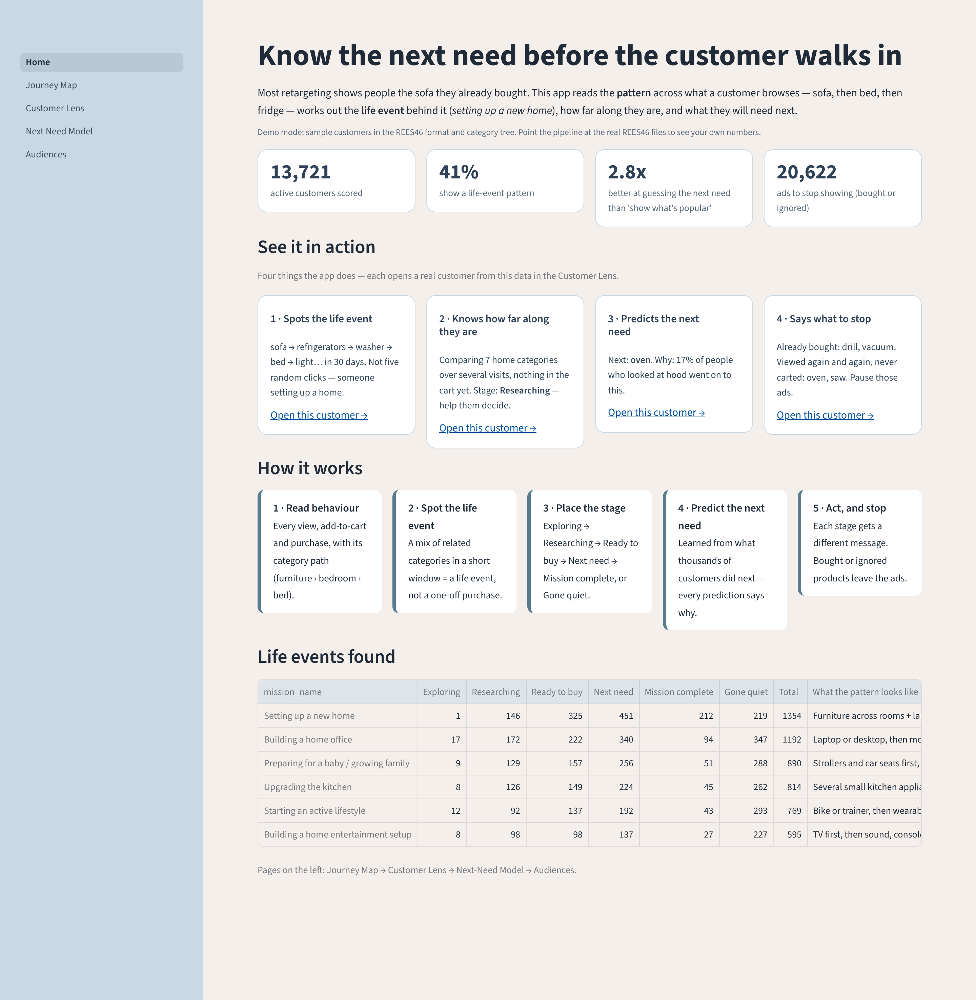
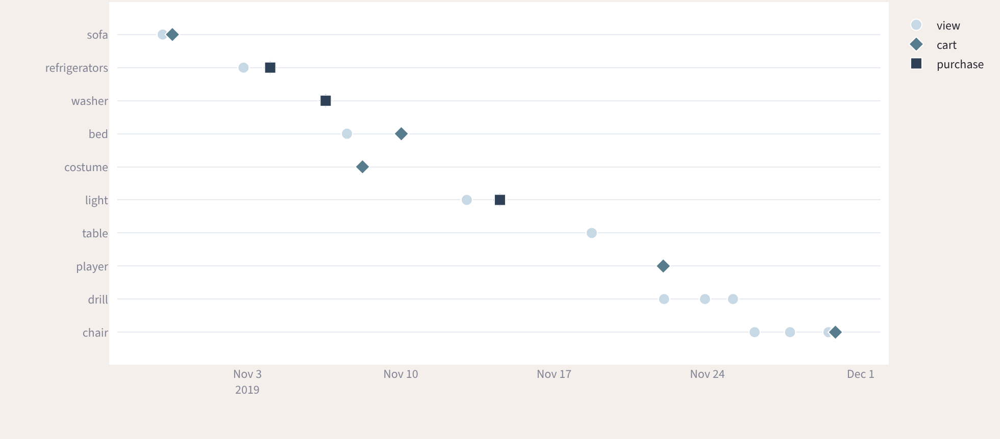
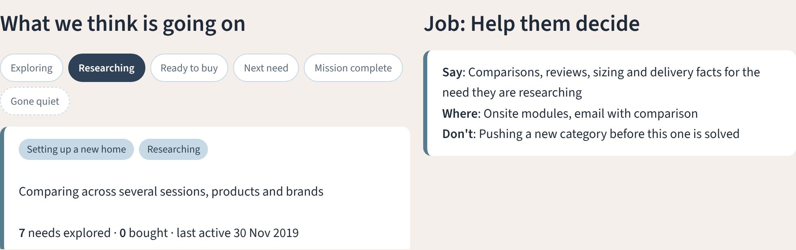
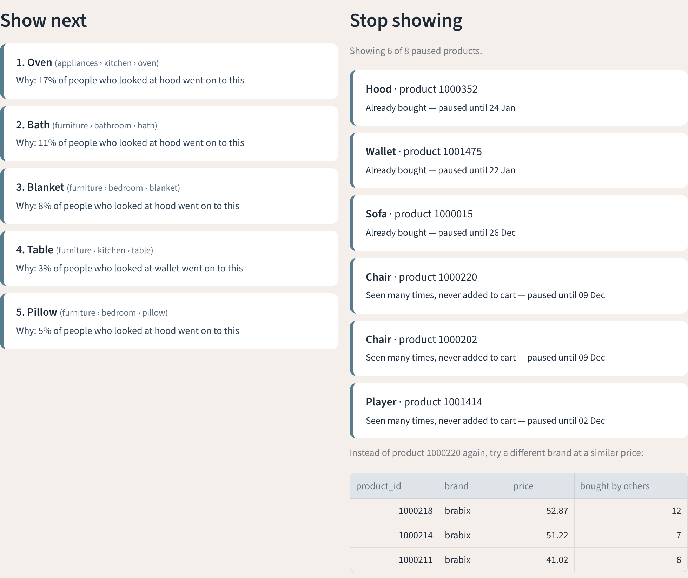
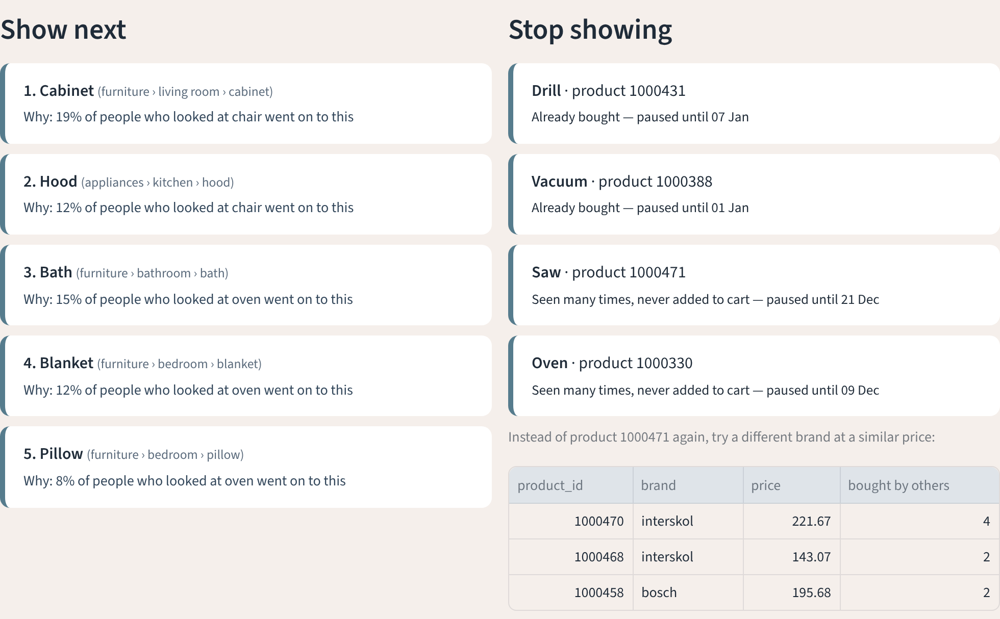

# Customer Journey Intelligence

**Know what your customer needs next — before they walk into your store.**

A customer buys a sofa on Monday. For the next three weeks, every ad they see is… the same sofa.
Meanwhile they're browsing beds, fridges and a drill, because they've just moved into a new home —
and your competitor is the one who shows them the bed.

So let's build a system that reads the *pattern* across what a customer browses, works out the
**life mission** behind it, places them on a **journey stage**, predicts their **next need**, and
**stops** showing them things they already bought.

**Live app:** _add your Streamlit link here after deploying (see "Put it online" below)_

<p align="center"></p>

---

## What it does

| Step | Question | How |
|---|---|---|
| 1. Detect the mission | *What life event is this person in?* | Breadth across related needs in a short window. One sofa = a sofa shopper. Sofa + bed + fridge = setting up a home. |
| 2. Place the stage | *How far along are they?* | Exploring → Researching → Ready to buy → Next need → Mission complete, or Gone quiet. Transparent rules, all in `config.py`. |
| 3. Predict the next need | *What will they look for next?* | Need-to-need transitions learned from the order thousands of customers explored categories. Every prediction says *why*. |
| 4. Act — and stop | *What do we do, and not do?* | Each stage gets a different job (inspire, help decide, remove friction, serve next need, make loyal, win back). Bought and fatigued products are suppressed. |
| 5. Prove it | *Is it better than what we do today?* | Backtest vs "show what's popular", plus a holdout experiment design for the causal question. |

Missions defined out of the box: **setting up a new home · preparing for a baby · building a home office ·
upgrading the kitchen · starting an active lifestyle · building a home entertainment setup.**
Add your own in `src/journey/config.py`.

## The data

[REES46 — eCommerce behavior data from multi category store](https://www.kaggle.com/datasets/mkechinov/ecommerce-behavior-data-from-multi-category-store)
(free on Kaggle). One row per event — `view`, `cart`, `purchase` — with a readable category path such as
`furniture.living_room.sofa`, `kids.carriage`, `appliances.kitchen.refrigerators`. October 2019 is the
history; November 2019 is "what happened next".

The repo also ships a **demo generator** in the exact same schema so anyone can clone and click through the
app in under a minute. Demo numbers prove the code runs — they are **not** findings. Run on the real files
before quoting any number.

## Quick start

```bash
git clone https://github.com/DevinderKaurLabs/Customer_Journey_Intelligence.git
cd Customer_Journey_Intelligence
python -m venv .venv && source .venv/bin/activate      # Windows: .venv\Scripts\activate
pip install -r requirements.txt

# Option 1 - demo data (1 minute)
python scripts/make_demo_data.py
python scripts/run_pipeline.py --demo
streamlit run app/Home.py

# Option 2 - real REES46 data
python scripts/download_data.py          # needs a Kaggle API token, see the script
python scripts/run_pipeline.py --sample 20   # 1 in 20 customers; lower = more data, slower
streamlit run app/Home.py

pytest -q
```

`outputs/results.md` is written on every run with the headline numbers, ready to paste into a write-up, and
`outputs/showcase.json` holds one example customer per use case.

Screenshots of every page (after a pipeline run):

```bash
pip install playwright && python -m playwright install chromium
python scripts/take_screenshots.py      # -> outputs/screenshots/
```

## Put it online (Streamlit Community Cloud, free)

1. Push this repo to GitHub.
2. Go to [share.streamlit.io](https://share.streamlit.io) → **Create app** → **Deploy a public app from GitHub**.
3. Repository `DevinderKaurLabs/Customer_Journey_Intelligence`, branch `main`, main file `app/Home.py` → **Deploy**.

The first visit builds the demo data and runs the pipeline (about a minute); after that it is instant.

## The app

<p align="center">

<br>


</p>

| Page | What you see |
|---|---|
| **Home** | Customers scored, share in a life event, model lift, ads to stop. "See it in action": one real customer for each use case. Life events × stages table. |
| **Journey Map** | Sankey of "where people go next" inside each mission, with the share and customer count on every path. |
| **Customer Lens** | One customer end to end (shareable link: `Customer_Lens?customer=<id>`): browsing timeline, detected mission and stage, the job for that stage, top next needs with reasons, and the stop-list (bought / fatigued) with alternative products. |
| **Next-Need Model** | Backtest vs popularity by segment, what we learned, and what would change our mind. |
| **Audiences** | Mission × stage audiences with their playbook, top next needs, CSV export of the audience and its suppression list, and the journey-depth vs repeat-rate table. |

## How it works

```
src/journey/
├── config.py        missions, weights, thresholds, palette — everything tunable
├── data_loader.py   stream the 5-9 GB files, sample by user (keeps journeys whole), clean
├── missions.py      mission detection (breadth + recency-decayed intent) and stage rules
├── next_need.py     transition model, batch scoring with reasons, backtest vs popularity
├── suppression.py   bought / fatigued stop-lists, alternatives, retargeting waste
├── value.py         mission depth vs next-month behaviour, next-need opportunity score
├── actions.py       stage playbook → one decision per customer
├── showcase.py      one clear example customer per use case
└── charts.py        static charts for README / posts
scripts/   make_demo_data.py · download_data.py · run_pipeline.py · take_screenshots.py
app/       Streamlit app (Home + 4 pages)
docs/      experiment_design.md — the holdout test for the causal question
tests/     hand-built journeys that check each rule
```

**Mission score.** Each event is weighted (view 1, cart 3, purchase 5) and decayed with a 14-day half-life.
A mission qualifies when the score passes a threshold **and** the customer touched enough distinct needs in it
(3 for a new home, 2 for the others). Breadth is the signal; volume alone is not.

**Next need.** For every customer we take the order in which they *first* engaged with each need. We count
how often need A is followed by need B within the next 3 steps (closer steps weigh more), normalise per A,
and score candidates for a customer from their recent, strongest needs. Needs they already explored or bought
are excluded. Each output carries its reason, in the form "X% of people who looked at sofa went on to this".

**Backtest.** Freeze history at 1 Nov 2019. Predict top-5 next needs. A hit = the customer explored at least
one *brand-new* need in November that was in our top 5. Baseline = the most popular new needs.

**Suppression.** Bought → stop showing that product (and its need) for 60 days. Fatigued → 5+ views across
3+ sessions with no add-to-cart → stop, and swap to a different brand at a similar price.

## What the real dataset tells you (October 2019)

From public analyses of the REES46 October file
([ecommerce-clickstream-analytics](https://github.com/Oyegun22/ecommerce-clickstream-analytics),
[marketplace-recs](https://github.com/mateus-aleixo/marketplace-recs)):

- 42.4M events from 3.0M people across 9.2M sessions and about 167k products.
- About 96% of events are views; carts are about 2.2% and purchases about 1.75%. Browsing is where the signal is.
- Only about 1 in 9 visitors buys anything in the month (347k buyers of 3.0M users).
- 54% of purchase sessions have no add-to-cart event — "carted" is not a reliable intent signal on its own.
- 51% of carted products are not bought.
- Buyers with 2+ purchase sessions are 32% of buyers but 69% of revenue — repeat customers carry the business.
- Electronics is 77% of revenue and smartphones alone 68%.
- "Most popular products" finds the next product in the top 20 only 8.5% of the time; using what was viewed together reaches 44%.

## Results

See [`outputs/results.md`](outputs/results.md) — regenerated on every run. The committed version is from the
demo data and is labelled as such.

## Being honest about what this is

- **Prediction, not persuasion.** The model shows who will look at what next. Whether *messaging* them changes
  what they buy needs a holdout test — designed in [`docs/experiment_design.md`](docs/experiment_design.md).
- **Mission depth vs repeat rate is a correlation.** Engaged customers both browse more and buy more.
- **"Next-need opportunity" is a prioritisation heuristic** (likelihood × typical basket), not a CLV forecast.
- **The life event decides the message; the sequence decides the product.** Re-ranking candidates inside the detected
  life event is available as an option (`mission_boost` in `config.py`) and is reported separately in `outputs/evaluation.csv`.
- Mission rules are hand-written for this catalog. A different retailer needs its own `MISSIONS`.

## Roadmap

- Uplift model on the holdout to target customers whose behaviour *changes* when messaged
- Sequence model (GRU / transformer) vs transitions — only if it beats the explainable baseline by a margin worth losing explainability
- Live scoring API (FastAPI) fed by GA4 / CDP events
- Mission discovery from data (clustering co-browsed needs) instead of hand-written rules

---

Built by **Devinder Kaur Padam** — customer analytics, loyalty and AI.
[LinkedIn](https://linkedin.com/in/devinder-kaur-padam) · [Portfolio](https://devinder-kaur.vercel.app) · [Substack](https://substack.com/@devinderkp)
